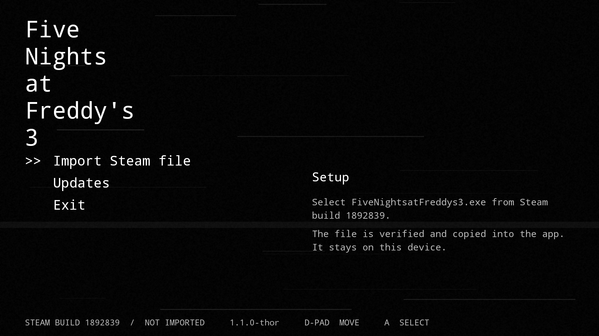
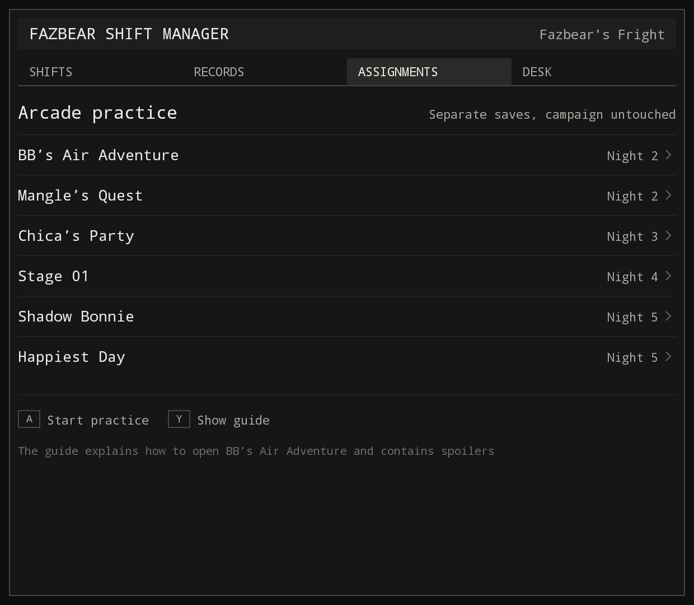
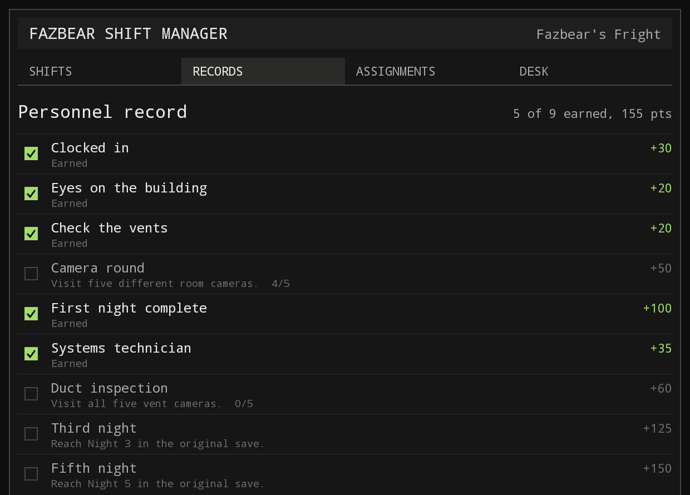
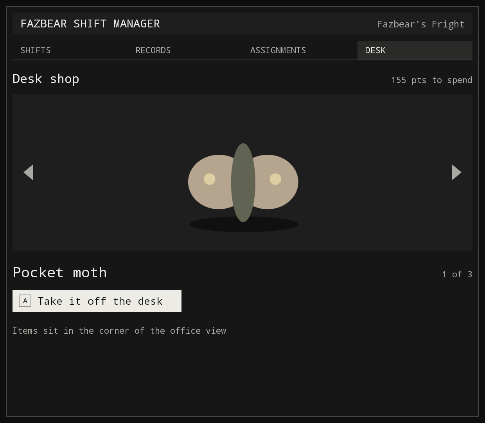
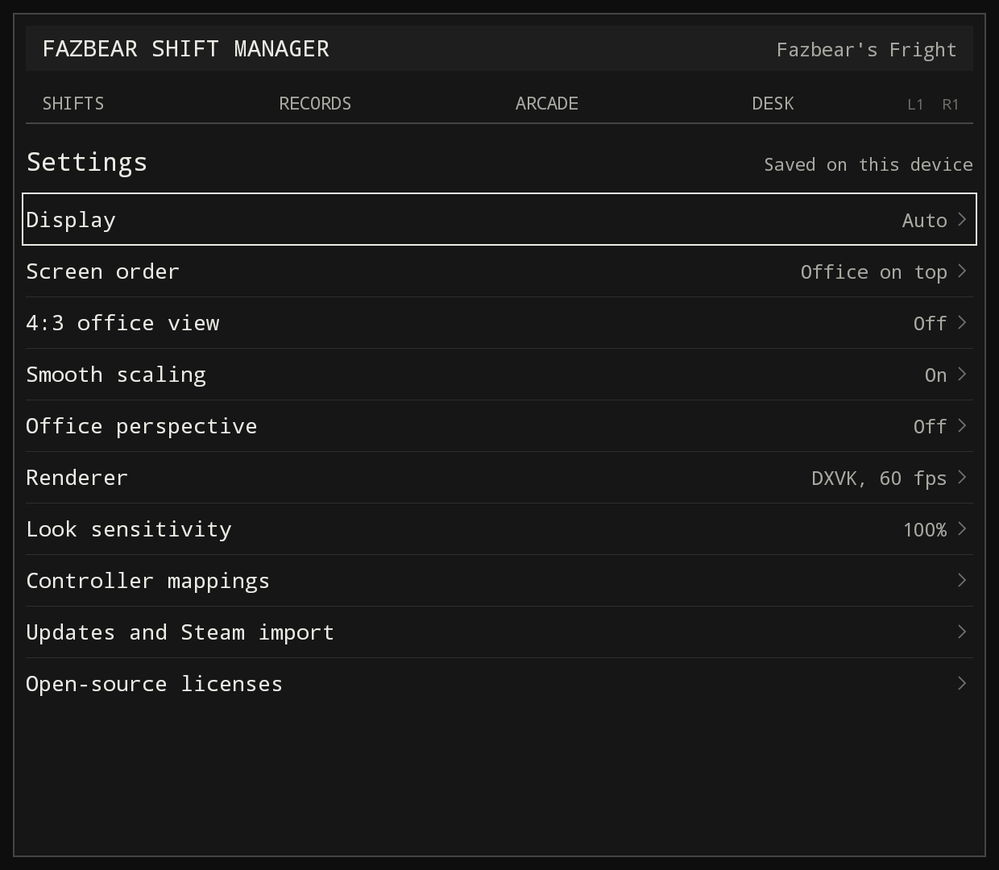
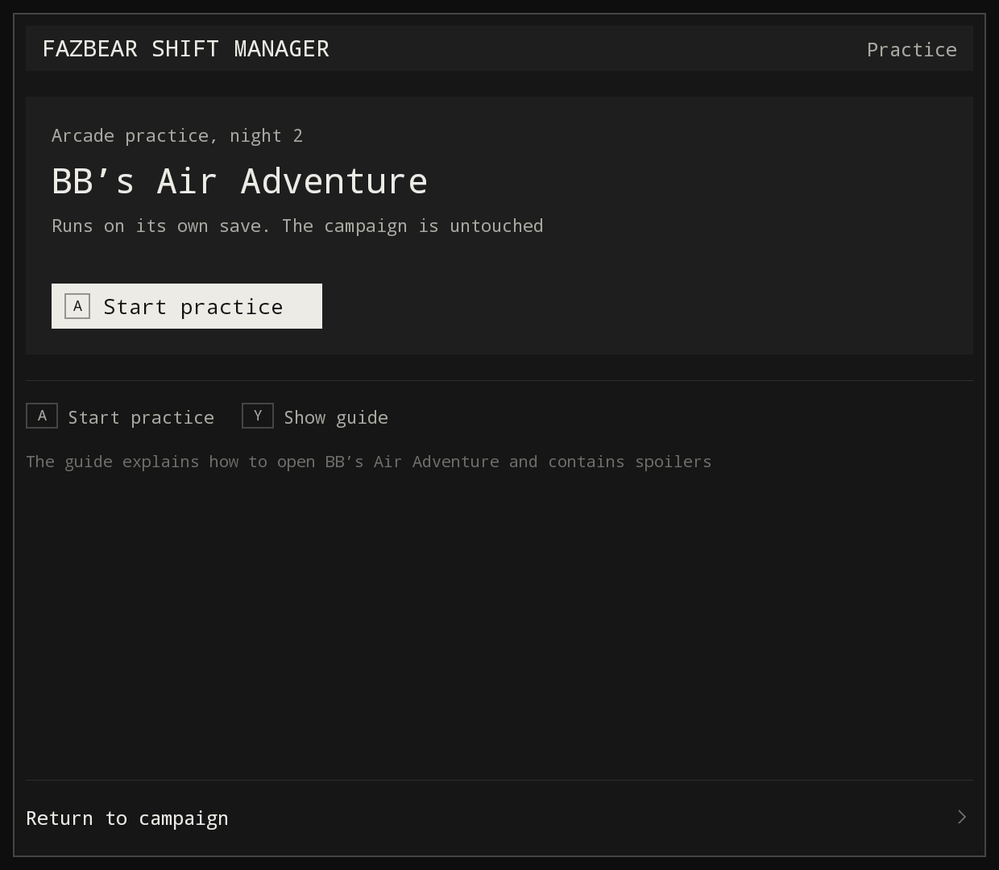
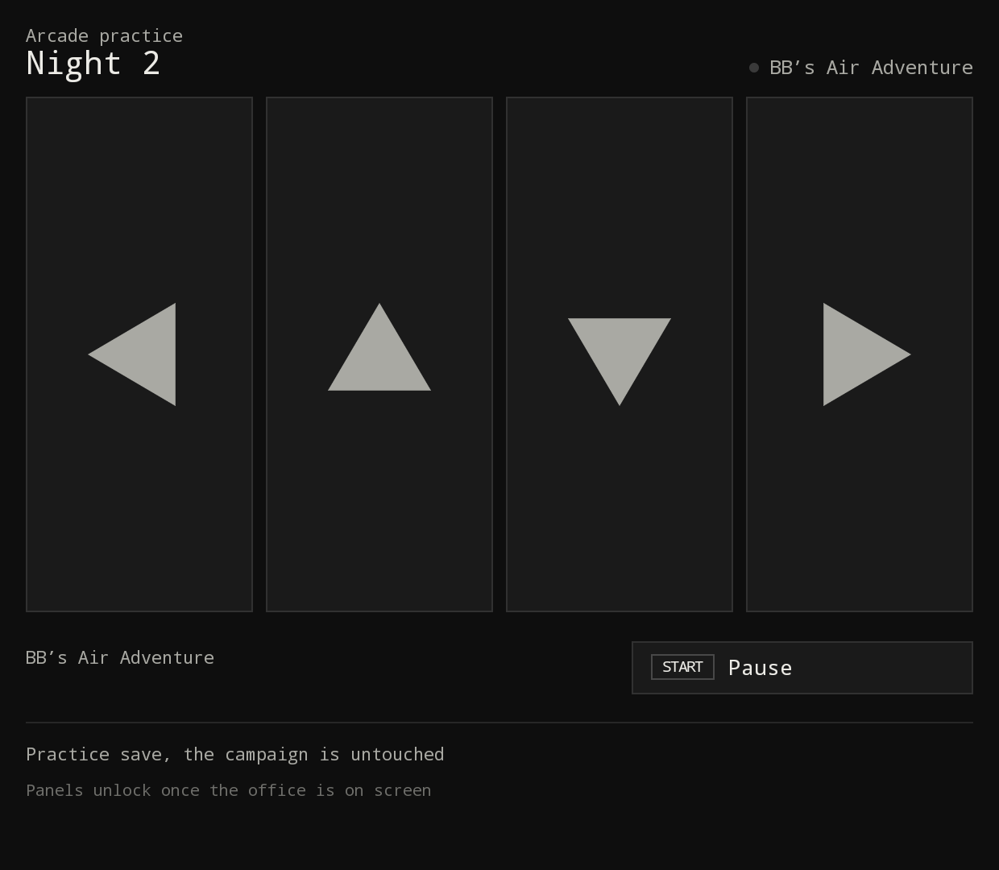
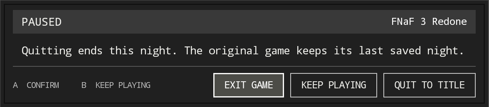
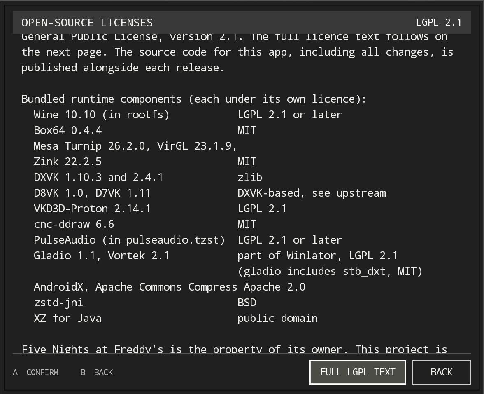

# FNaF 3 Redone for Android and AYN Thor

An unofficial Android launcher and dual-screen companion for the Steam release of Five Nights at Freddy's 3. It runs **your own copy** of the game, unmodified, through a bundled Wine and Box64 runtime based on [Winlator](https://github.com/brunodev85/winlator-app). The APK contains no game files.



## What you need

- An ARM64 Android device running Android 8 or newer. Built and tested on the AYN Thor; other devices use a single-screen layout.
- Your own Steam copy of Five Nights at Freddy's 3, **build 1892839**. The app checks the file's size and SHA-256 and rejects any other build.

## Install

1. Download `FNaF3-Redone-Thor-1.1.0.apk` from [Releases](../../releases) and install it.
2. Copy `FiveNightsatFreddys3.exe` from your Steam install to the device.
3. Open the app, choose **Import Steam file**, and select the executable. It is verified and copied into the app.
4. Choose **Play**. The first launch unpacks the runtime once, behind the title.

Updating from 1.0 keeps your saves, points and unlocks.

## How it plays

- **One title.** Like FNaF 1 and 2 Redone, the app opens straight onto the title: New Game, the saved night, Arcade, Achievements, Desk Shop, Settings and Exit. Choosing a night starts it directly.
- **Lower screen.** The Fazbear Shift Manager between nights shows shifts, records, arcade practice and the desk shop. During a night the Security Desk takes over, with Cameras and Maintenance as large controls. Both use interface art read from your imported executable at runtime.
- **Dual screen.** The office sits above and the cameras below by default. Settings can swap the screens or use a single screen.
- **Arcade practice.** All six minigames, each on its own save, with guides hidden until you open them.

## Screenshots

The lower screen between nights, in the Fazbear Shift Manager:

| Arcade practice | Personnel record |
|---|---|
|  |  |

| Desk shop | Options |
|---|---|
|  |  |

Arcade practice runs each minigame on its own save. The guide stays hidden until you press Y, and hold-to-move keys appear on the lower screen while a minigame plays:

| Practice session | Minigame controls |
|---|---|
|  |  |

START pauses any night:



The licence page under Settings lists every bundled runtime component:



## Controls

| Button | Action |
|---|---|
| D-pad, left stick | Move through menus; in the office, look left and right |
| A | Select; in a night, click |
| B | Back |
| L1 / R1 | Switch Shift Manager tabs; in cameras, vent map / play audio |
| X | Raise or lower the camera monitor |
| L2 | Open or close maintenance |
| D-pad up and down | In maintenance, choose a system |
| R2 | Save a camera snapshot |
| Y | Mute the phone call |
| START | Pause menu |

All bindings can be changed under Settings, Controller mappings.

## Build

```
./gradlew :app:assemblePrivatePreview
```

The `privatePreview` build type is non-debuggable and signed with the local debug key. Updates must be signed with the same key as the installed copy.

## Licence

The app is based on Winlator and is distributed under the GNU Lesser General Public License 2.1 (see [LICENSE](LICENSE)). The bundled runtime components and their licences are listed in [NOTICE.txt](NOTICE.txt) and in the app under Settings, Open-source licenses. Upstream source links are in [RELEASE-NOTES.md](RELEASE-NOTES.md). The original Winlator readme is kept in [docs/WINLATOR-README.md](docs/WINLATOR-README.md).

Five Nights at Freddy's is the property of its owner. This project is not affiliated with or endorsed by them.
